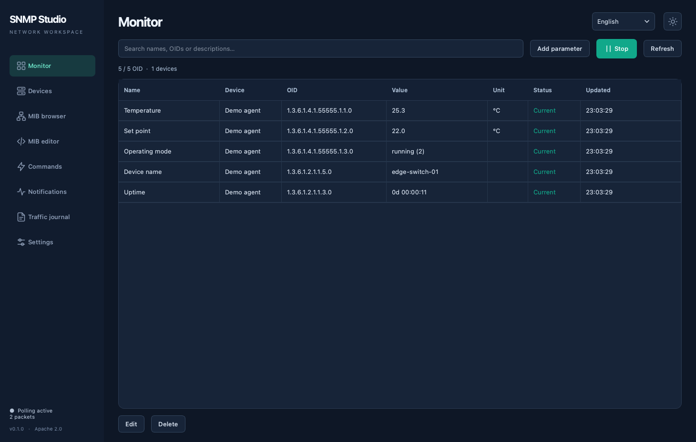
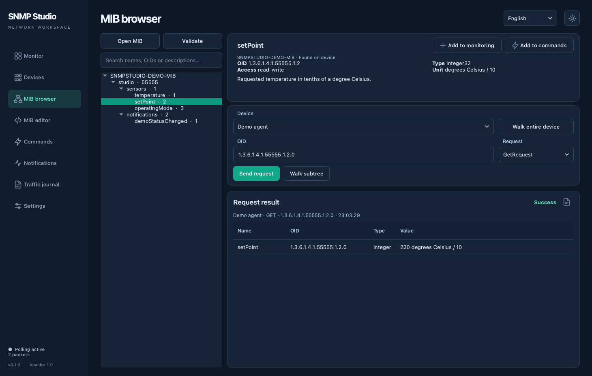
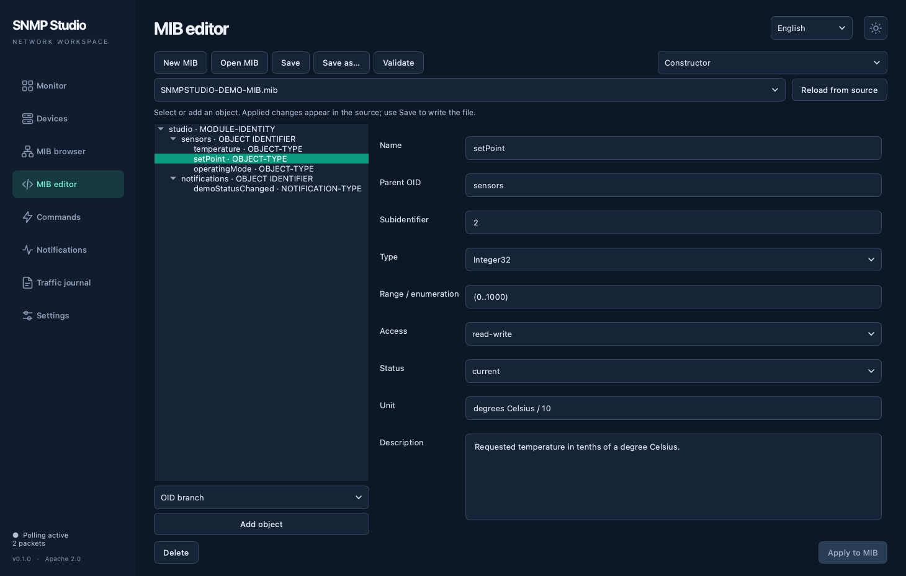
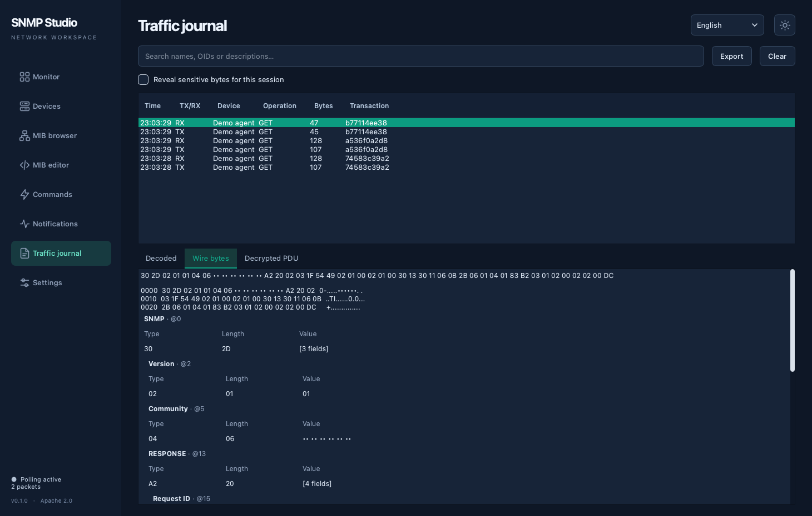

# SNMP Studio

**English** | [Русский](README.ru.md)

A cross-platform SNMP workstation for device monitoring, MIB browsing, an optional source editor, SET commands, and a journal of actual network traffic.

Development version: **0.1.0**. License: **Apache 2.0**.

The application is called **SNMP Studio**, the repository and project directory are named `snmp-studio`, and the launch command is `snmpstudio`.

<!-- toc:start -->

## Table of contents

- [Features](#features)
- [Screenshots](#screenshots)
- [MIB browser and editor](#mib-browser-and-editor)
- [Running from source](#running-from-source)
- [Demo](#demo)
  - [Starting from the application](#starting-from-the-application)
  - [Standalone agent in a terminal](#standalone-agent-in-a-terminal)
  - [Demo MIB objects](#demo-mib-objects)
  - [Isolated demo mode](#isolated-demo-mode)
- [Your first device](#your-first-device)
- [SNMPv3 and secrets](#snmpv3-and-secrets)
- [SET commands](#set-commands)
- [Notifications](#notifications)
- [Configuration and logs](#configuration-and-logs)
- [Building installers](#building-installers)
- [Checks](#checks)
- [Current limitations](#current-limitations)
- [License](#license)

<!-- toc:end -->

## Features

- SNMPv1, SNMPv2c, and SNMPv3 over UDP, with IPv4 and IPv6.
- Multi-OID GET, GETNEXT, GETBULK, and WALK of a selected subtree.
- Batched OID requests, splitting on `tooBig`, and handling of individual missing objects.
- Monitoring in a shared table, with start/stop controls and one-time refresh.
- Per-parameter intervals, decimal scaling, and units.
- Counter64 without conversion to float; TimeTicks displayed as a duration.
- Single- and multi-OID SET, saved commands, and read-back verification.
- Trap and Inform reception, with Inform acknowledgments.
- Inspection of actual TX/RX packets, ASN.1/BER, HEX, ASCII, field types and lengths, OIDs, and values.
- SNMPv3 encrypted bytes as transmitted, alongside the decrypted PDU.
- SQLite storage and JSON import/export without secrets.
- Russian and English interfaces, with two themes switched using an icon.

## Screenshots

The application in the dark theme with an English interface and the built-in demo agent.

**Monitoring** — live values, units, and polling status.



**MIB browser** — object properties and a successful GET request.



**MIB constructor** — visual editing of object properties.



**Traffic journal** — actual SNMP packets and their wire bytes.



## MIB browser and editor

**The editor is disabled by default.** MIB browsing is available immediately: an object tree, search by name/OID/description, types, units, enumerations, and access permissions.

Select a device and an object in the tree. On the right, below the OID properties, you can use **GetRequest**, **GetNextRequest**, **GetBulkRequest**, **SetRequest**, or the separate **Walk subtree** button. GetBulkRequest lets you set the maximum number of repetitions; this operation is unavailable in SNMPv1. **Walk entire device** walks the entire accessible OID space, even without a loaded MIB. Walks can be canceled.

After a successful **GetNextRequest**, the returned OID is automatically selected in the tree, displayed in the properties, and used for the next request. You can step through a device by repeatedly clicking **Send request**. The response remains visible, and the tree expands and scrolls to the OID. If a search hides the next OID, the filter is cleared. Reaching the end of the range, an error, or cancellation leaves the selection unchanged.

Selecting **SetRequest** reveals fields for the type and raw value. A confirmation appears before writing; the request and response are available in the results and traffic journal.

When a request finishes, its status is shown as **Success** or **Error**, followed by MIB names, response OIDs, types, values, and individual object errors. Error details appear in a dismissible panel below the results. The response context includes the device, operation, original OID, and request time. Actual packets are available in the traffic journal.

The **Add to monitoring** and **Add to commands** buttons sit at the top right of the OID properties block. Unavailable actions are hidden. **Add to monitoring** is available for readable objects; **Add to commands** is available for writable objects. Both appear for `read-write` objects. **Add to commands** opens a configuration dialog: you can change the MIB-derived name, device, type, and raw value, while the exact instance OID remains fixed. If a value has already been read from the device, it pre-fills the dialog. Saving creates a named command in the local database; canceling adds nothing.

**Add to monitoring** opens a dialog with the selected MIB object's name, unit, and OID. Scalar objects automatically receive the `.0` suffix. For a table column, enter an instance index in the OID field before opening the dialog, or select a returned row from GETNEXT, GETBULK, or a subtree walk. The OID is fixed in the dialog; you can change the name, unit, decimal shift, multiplier, value offset, precision, and polling interval. Confirming saves the parameter in the local database.

The results table displays **Name** first, followed by **OID**. Unknown OIDs show **Not in MIB** in the name column.

A device may return OIDs absent from the MIB. These appear in the tree as **Not in MIB** and can be read and monitored. After a completed walk, objects that were not discovered are marked **Not found**; the mark disappears if they reappear. This state belongs to the selected device and access profile, lasts for the current session, and does not modify MIB source files. A failed or canceled walk does not confirm that an OID has disappeared.

Open **Settings → Enable MIB editor**. A separate **MIB editor** entry appears in the left menu, immediately below **MIB browser**.

The editor has **Constructor** and **Source** modes that work with the same document. **New MIB** opens a form for the module name, root object, subidentifier, organization, contact details, and description, then opens the constructor.

In the constructor, select a parent object in the tree, choose the new object type—OID branch, parameter, notification, object identity, or module identity—and click **Add object**. Parameters support a type, range or enumeration, access permissions, status, unit, and description; notifications support an object list. The constructor selects an unused subidentifier in the chosen branch and adds required imports. Existing object properties are edited in the same form. Renaming updates references within the current module; a name imported by another open MIB must be updated in its source.

**Apply to MIB** updates the source and supports Undo. **Save** writes the file; built-in examples use **Save as**. Manual edits appear in the constructor when you switch modes or click **Reload from source**. If they conflict with an unsaved form, the constructor does not overwrite them. Syntax errors, duplicate OIDs, and deleting an object that is still referenced block the change.

On **Save** and **Save as**, the built-in formatter uses **4-space indentation** to reflect the OID tree: branches and child parameters receive the corresponding nesting, with an additional indent for object properties. Declaration order is preserved. Formatting requires no `smidump` or other external tools and does not convert SMIv1 to SMIv2.

Comments are preserved, including comments inside legacy ASN.1 macros; descriptions and string values are left intact. After saving, the formatted text appears in the editor and can be reverted with Undo. A formatting error or an externally modified file leaves the original file and draft intact. After confirmation, a draft with syntax errors can be explicitly saved without formatting.

The constructor preserves comments and other declarations, including module revisions. Complex tables, `SEQUENCE`, textual conventions, conformance groups, and other SMI declarations remain available in **Source**; existing declarations of these kinds are not converted to simplified templates. The constructor handles one module per file and resolves dependencies from open MIBs.

The editor also provides:

- Source file tabs, SMI syntax highlighting, and line numbers.
- Navigation from the browser to an object's definition by double-clicking or choosing **Open in editor** from the context menu.
- Syntax validation with diagnostics and navigation to the error line.
- Diagnostics for missing imports and unresolved OIDs.
- A dismissible diagnostics panel: reviewed errors do not reappear during background validation. **Validate** opens the full list again.
- Find and replace, undo/redo, and completion with `Ctrl+Space`.
- MIB creation, saving, and **Save as**.
- Protection against overwriting a file modified by another program.

The browser remains a viewing page; source text, tabs, search, and saving are on the separate editor page. Switching pages preserves open files and unsaved changes. The editor preference is saved in the configuration. Disabling the editor prompts you to save changes and removes **MIB editor** from the menu. File editing controls and their keyboard shortcuts are hidden or disabled while the editor is off.

An object's context menu lets you copy its OID/symbol, add a parameter to monitoring, or prepare SET for a writable object. MIBs are parsed as SMI data through PySMI: imported text is not executed as Python. Network downloading of MIB dependencies is disabled; import required modules locally. Numeric OIDs also work without MIBs.

The built-in demo MIB is a template. Use **Save as** to save changes to a user file.

## Running from source

Requires Python 3.12 or newer.

```bash
python3 -m venv .venv
source .venv/bin/activate
python -m pip install -r requirements.txt
python -m snmpstudio
```

Install the local project to make the launch command available:

```bash
python -m pip install -e .
snmpstudio
```

The working configuration is saved in the application data directory chosen by the OS. To use a separate database:

```bash
python -m snmpstudio --db ./workspace.db
```

## Demo

The demo agent implements the built-in `SNMPSTUDIO-DEMO-MIB` objects and responds to real SNMPv1/v2c UDP requests: GET, GETNEXT, GETBULK, and SET. It also sends SNMPv2c TRAP/INFORM and receives SNMPv1 TRAP and SNMPv2c TRAP/INFORM on its UDP port, acknowledging INFORM. It is available in the regular application, in isolated demo mode, and as a separate process without a window.

### Starting from the application

On normal startup, the application restores user MIBs. The built-in demo MIB opens automatically when the demo agent starts.

1. Open **Settings → Demo agent**.
2. Select a UDP port: the default is `1161`; **Auto** selects a free port.
3. Click **Start agent**. Its profile automatically appears in the device list and is selected in the MIB browser. The address and port are filled from the running agent, with `public` for reading and `private` for writing. The built-in `SNMPSTUDIO-DEMO-MIB` opens automatically, so you can select an OID and send requests immediately. Open MIBs and unsaved changes are preserved; restarting updates the demo profile without duplicates.
4. Optionally, click **Add to monitor** to add the demo MIB objects, device name, and uptime. Repeating this action does not duplicate parameters. The demo device is read immediately, without changing polling of other devices. This step is unnecessary for one-time requests in the MIB browser.
5. For continuous updates, start polling on the Monitor page.

Credentials are filled automatically: community `public` for reading and `private` for writing. Demo profile secrets remain in session memory. After restarting the application, start the demo agent again to refill the credentials. Automatically adding the device does not start continuous polling or add monitoring parameters.

The agent listens on `127.0.0.1` and stops when you click the stop button or close the application. It does not start in normal mode unless explicitly requested.

### Standalone agent in a terminal

From the activated project environment:

```bash
python -m snmpstudio.simulator --port 1161
```

After `pip install -e .`, you can also use `snmpstudio-agent --port 1161`.

Connect from regular SNMP Studio or another SNMP client:

| Field | Value |
|---|---|
| Address | `127.0.0.1` |
| UDP port | `1161` |
| Version | SNMPv2c or SNMPv1 |
| Read community | `public` |
| Write community | `private` |
| WALK subtree | `1.3.6.1.4.1.55555` |

Open `snmpstudio/data/SNMPSTUDIO-DEMO-MIB.mib` in the MIB browser. Use the `.0` instance suffix for scalar objects.

Additional agent options:

```bash
python -m snmpstudio.simulator --host ::1 --port 1162
python -m snmpstudio.simulator --port 1161 --static --verbose
python -m snmpstudio.simulator --help
```

`--static` keeps the temperature unchanged. `--verbose` prints request/response addresses and sizes. Stop with `Ctrl+C` to release the port. If the port is in use, the agent reports an error. Set custom communities with `--read-community` and `--write-community`.

### Demo MIB objects

| Object / instance OID | Access | Value |
|---|---|---|
| `temperature.0` / `1.3.6.1.4.1.55555.1.1.0` | Read | Temperature in tenths of °C |
| `setPoint.0` / `1.3.6.1.4.1.55555.1.2.0` | Read/write | Setpoint `0…1000`, also in tenths of °C |
| `operatingMode.0` / `1.3.6.1.4.1.55555.1.3.0` | Read/write | `1` — standby, `2` — running, `3` — maintenance |

With simulation enabled, temperature gradually approaches the setpoint in `running` mode, approaches `25.3 °C` in `standby`, and stays at its current level in `maintenance`. Use a multiplier of `0.1` to display a raw value of `253` as `25.3 °C`. Send raw integers with SET: for example, `300` for a setpoint of `30.0 °C`.

The agent validates types, ranges, and enumerations against the demo MIB, rejects temperature writes, and disallows writing through `public`. An invalid value cancels the entire SET. Values are held only in memory and reset when the agent restarts.

The enterprise number in the demo MIB is used for a local example and does not claim assignment to real equipment. The demo agent supports SNMPv1/v2c; SNMPv3 support in SNMP Studio itself is covered by separate integration tests.

### Isolated demo mode

```bash
python -m snmpstudio --demo --page monitor
```

This mode creates an in-memory configuration and starts the agent on a free local port. It does not replace the working configuration. Requests and responses appear in the journal. Agent controls are also available in Settings; closing the window stops the agent.

## Your first device

1. Open **Devices** and add the address, port, SNMP version, and credentials.
2. Open **MIB browser**, select the device and an object, and optionally send a request or walk a subtree.
3. Click **Add to monitoring**. Scalar objects receive `.0` automatically; for a table column, first select an instance from the response or enter the row index in the OID field. You can also add a numeric OID directly from the Monitor page.
4. Set the unit, multiplier, and polling interval.
5. Start polling on the Monitor page.
6. To inspect traffic, open **Traffic journal** and select TX or RX.

Symbolic names use the `MODULE::object.instance` format. The device must allow access from your computer's address and support the selected objects.

## SNMPv3 and secrets

Supported security levels are `noAuthNoPriv`, `authNoPriv`, and `authPriv`, with SHA-256/SHA-512/SHA-1/MD5 authentication and AES-128/DES encryption. New profiles default to `authPriv`, SHA-256, and AES-128.

Enter the username and passwords. The engine ID for requests is discovered automatically; set `contextName` and Context Engine ID if needed. For authenticated/encrypted Traps, specify the sender's **Trap Engine ID** in HEX in the profile. For Inform, the receiver is the authoritative engine; its parameters must match the sender's configuration.

Communities and passwords stay in memory until the session ends. The save checkbox uses the system Keychain on macOS or Secret Service on Linux. If the system keyring is unavailable, the application reports that secrets will remain in memory only. SQLite and regular JSON exports do not contain these credentials.

Communities are hidden in both the field tree and HEX/ASCII views. You can explicitly enable sensitive byte display in the journal for the current session. Journal export always masks communities, regardless of that switch.

## SET commands

A command contains exact OIDs, types, and **raw values**. Monitoring scaling does not apply to SET. A confirmation lists the values before sending.

SET is never retried automatically. A timeout means the outcome is unknown: the device may have applied the command even if the response was lost. Resending is a user action. A command with side effects may not support read-back verification.

**Commands** contains saved entries only. **Add** opens a manual creation dialog: enter the name, device, OID, type, and raw value, and optionally enable read-back after SET. Numeric OIDs work without a loaded MIB. `OctetString` text is sent as UTF-8; select `HexString` for arbitrary bytes. You can also create a command with **Add to commands** in the MIB browser properties of a writable OID. When adding from a MIB, the name, device, type, and raw value are pre-filled and editable; the OID is fixed. The OID also remains fixed when editing a saved command. Saving does not send the command to the device. Periodic polling performs reads only.

The table shows the name first, followed by OID, device, type, and value. Search uses these fields. Select a row and click **Edit**, or double-click it: saving updates the same command without creating a copy. You can save separate commands with different names and values for different actions on the same OID. Previously saved multi-OID commands keep their grouping and are sent as a single SET.

To delete a command, select it and click the trash icon. After confirmation, the entry is removed from the local database; another command is not automatically selected. If its device is deleted, the command remains, with sending disabled until you choose another device in the edit dialog. Saved commands are included in configuration import/export.

**Send SET** runs the selected saved command after confirmation. Editing and deletion are disabled while it is being sent. **Success** or **Error** appears below, along with the response and read-back result if enabled. You can copy or clear the result, or open the journal to inspect the request and response as decoded fields and bytes.

## Notifications

On the Notifications page, set the address and port, then start the receiver. The default is `127.0.0.1:10162`, for local traffic without administrator privileges.

For notifications from equipment, use the appropriate network interface address, or `0.0.0.0` for IPv4 / `::` for IPv6, and configure firewall access. Set the computer's address and the same port on the device. Port `162` requires suitable privileges or separate OS configuration.

Notifications are decoded using open MIBs: names appear alongside OIDs, enumerations include labels and numbers, BITS show the names of set flags, and values include units. Loaded textual conventions are respected, including decimal `DISPLAY-HINT d-N` and byte-by-byte HEX `1x`. Unknown objects retain their raw OIDs and values, marked **Not in MIB**. Loading or closing a MIB re-decodes the history.

Select a row to see the name and description of its `NOTIFICATION-TYPE` or legacy `TRAP-TYPE`, along with the parameter description. **Traffic journal** opens the corresponding packets with decoded fields and bytes.

The table has a separate column for the actual packet type: **TRAP** or **INFORM**. The receiver acknowledges Inform. The address and UDP port fields are aligned and explicitly labeled; they are locked while receiving. The history clear control is above the notification list.

Access profiles are taken from configured devices when the receiver starts; restart the receiver after changing credentials.

To try demo notifications:

1. Start the demo agent in Settings; its MIB opens automatically.
2. Start reception on the **Notifications** page, for example at `127.0.0.1:10162`.
3. In the **Demo test** row, select TRAP or INFORM and click **Send from demo agent**.

The `demoStatusChanged` notification contains temperature, setpoint, and operating mode. TRAP reports that it was sent; INFORM reports receipt of an acknowledgment. Sending happens once, without automatic retries. The demo agent can also receive notifications from an external sender on its own port, usually `1161`: they appear in the application as **Received by demo agent**, with the INFORM request and acknowledgment available in the journal. You do not need to start the application's separate receiver on the same port for this check. Demo agent reception is limited to its community and SNMPv1/v2c.

## Configuration and logs

Configuration is saved automatically in SQLite. Export/import is available in Settings. Before an import replaces the configuration, a database backup is created beside the JSON being imported (`*.before-import.db`). Secrets must be entered separately.

MIBs remain local files: JSON stores paths rather than copies of their contents. When moving to another computer, transfer the MIBs and open them at their new paths.

The session journal is limited to 10,000 messages and also bounded by packet data size. Old entries are evicted. Export produces JSON with direction, time, address, operation ID, masked HEX, and decoded PDU.

## Building installers

Build each architecture with the corresponding Python and libraries on the target OS.

```bash
python -m pip install -r requirements-release.txt
python scripts/package.py --format bundle
```

On macOS:

```bash
python scripts/package.py --format dmg --arch arm64
# On Intel macOS:
python scripts/package.py --format dmg --arch x86_64
```

On Ubuntu:

```bash
python scripts/package.py --format deb --arch arm64
# On Ubuntu x86_64:
python scripts/package.py --format deb --arch x86_64
```

Outputs are written to `release/`, alongside SHA256 checksums. To install a `.dmg`, drag the application into Applications. For a `.deb`, run `sudo apt install ./release/snmpstudio_0.1.0_<architecture>.deb`, replacing `<architecture>` with the package architecture.

By default, macOS builds are ad-hoc signed and not notarized. Set `MACOS_CODESIGN_IDENTITY` for Developer ID signing and `MACOS_NOTARY_PROFILE` for notarization. Without these settings, the installer is not a notarized release.

The `.github/workflows/release.yml` workflow defines macOS ARM64/Intel and Ubuntu ARM64/AMD64 builds. It creates artifacts but does not publish a GitHub Release itself.

## Checks

```bash
QT_QPA_PLATFORM=offscreen python -m unittest discover -s tests -v
python scripts/update_readme_toc.py --check
```

Integration tests use local UDP agents: SNMPv1/v2c, SNMPv3 SHA-256/AES-128, GET/SET/WALK, Inform, and real TX/RX bytes. GUI checks cover the editor being disabled by default and its saved preference. Physical equipment is tested separately; compatibility with every vendor is not assumed.

Tables of contents for both README files are generated from headings:

```bash
python scripts/update_readme_toc.py
```

## Current limitations

Long-term value history, charts, threshold alerts, automatic device discovery, and multi-user operation are outside the current version. Subtree walks are limited to 5,000 OIDs and 30 seconds; entire-device walks to 50,000 OIDs and 120 seconds. Reaching a limit displays an error while preserving previous observations. WALK returns a list of OIDs and values; automatic construction of arbitrary multidimensional MIB tables is not yet implemented. Import replaces the configuration after confirmation; interactive configuration merging is not implemented.

MIB files must use UTF-8. The maximum file size is 4 MiB. Support for a particular nonstandard SMI dialect depends on PySMI; problems appear in diagnostics.

## License

[Apache License 2.0](LICENSE), [NOTICE](NOTICE), [third-party licenses](THIRD_PARTY_NOTICES.md).
