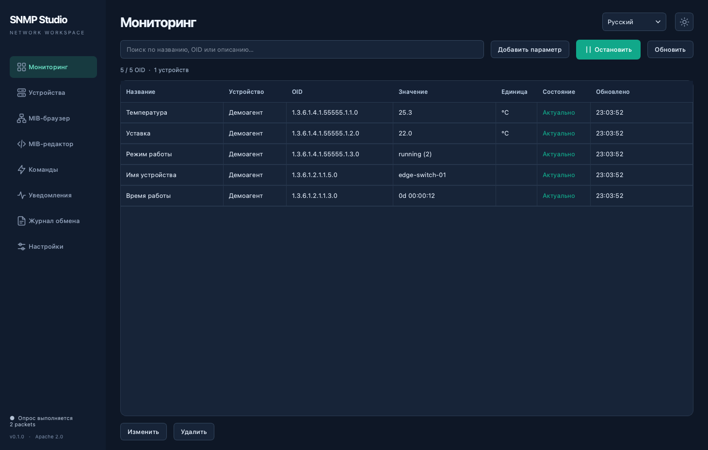
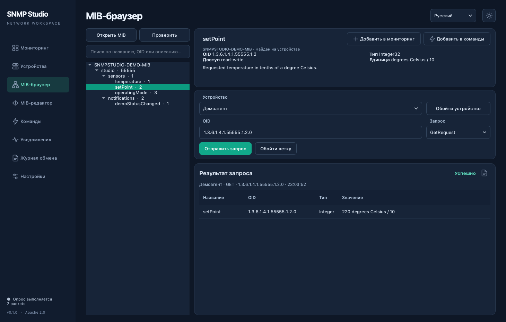
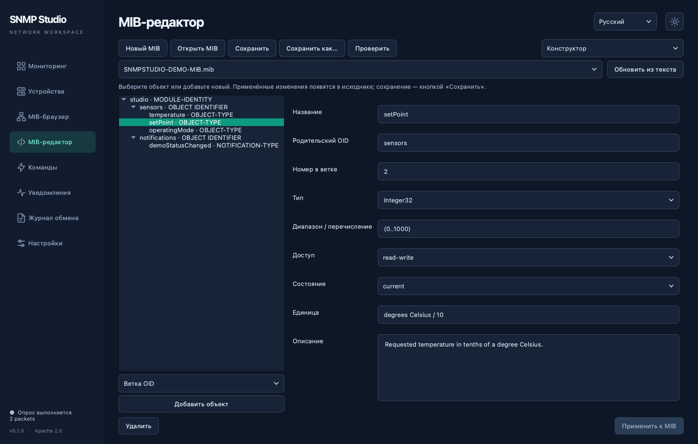
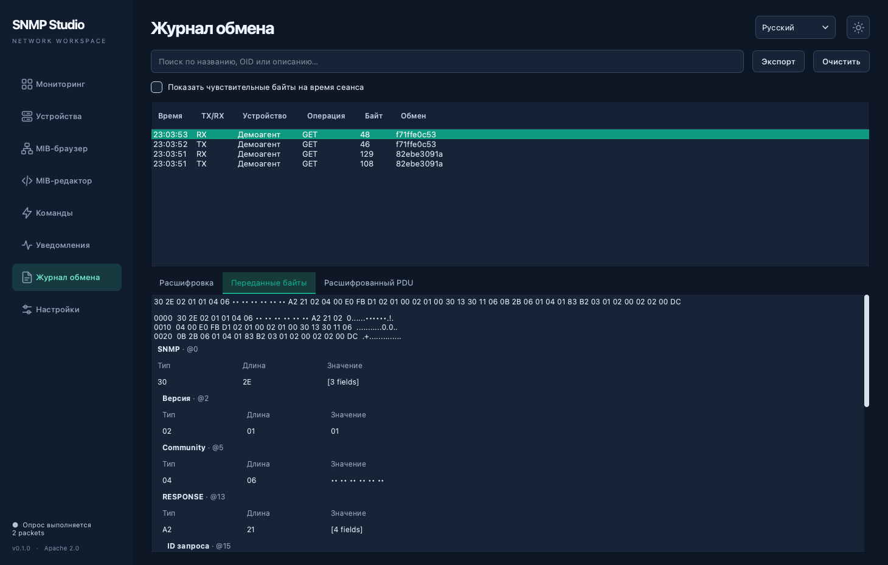

# SNMP Studio

[English](README.md) | **Русский**

Кроссплатформенная рабочая станция для SNMP: мониторинг устройств, браузер MIB, включаемый редактор исходного текста, команды SET и журнал реального сетевого обмена.

Версия: **1.0.0**. Лицензия: **Apache 2.0**.

Отображаемое имя приложения — **SNMP Studio**, имя репозитория и каталога проекта — `snmp-studio`, команда запуска — `snmpstudio`.

Установщики для macOS (Apple Silicon / Intel) и Ubuntu 24.04 (ARM64 / AMD64) доступны в [GitHub Releases](https://github.com/apayvin11/snmp-studio/releases/latest).

<!-- toc:start -->

## Оглавление

- [Возможности](#возможности)
- [Скриншоты](#скриншоты)
- [Браузер и редактор MIB](#браузер-и-редактор-mib)
- [Запуск из исходников](#запуск-из-исходников)
- [Демонстрация](#демонстрация)
  - [Запуск из приложения](#запуск-из-приложения)
  - [Отдельный агент в терминале](#отдельный-агент-в-терминале)
  - [Объекты демо-MIB](#объекты-демо-mib)
  - [Изолированный деморежим](#изолированный-деморежим)
- [Первое устройство](#первое-устройство)
- [SNMPv3 и секреты](#snmpv3-и-секреты)
- [Команды SET](#команды-set)
- [Уведомления](#уведомления)
- [Конфигурация и журналы](#конфигурация-и-журналы)
- [Сборка установщиков](#сборка-установщиков)
- [Проверки](#проверки)
- [Ограничения текущей версии](#ограничения-текущей-версии)
- [Лицензия](#лицензия)

<!-- toc:end -->

## Возможности

- SNMPv1, SNMPv2c и SNMPv3: UDP, IPv4 и IPv6.
- GET нескольких OID, GETNEXT, GETBULK и WALK выбранного поддерева.
- Объединение OID в запросы, разбиение группы при `tooBig` и обработка отдельных отсутствующих объектов.
- Мониторинг в общей таблице, запуск/остановка и разовое обновление.
- Индивидуальные интервалы, десятичное масштабирование и единицы измерения.
- Counter64 без преобразования в float; TimeTicks как длительность.
- SET одного или нескольких OID, сохранённые команды и контрольное чтение.
- Приём Trap и Inform с подтверждением.
- Просмотр фактических TX/RX-пакетов, ASN.1/BER, HEX, ASCII, типов и длин полей, OID и значений.
- SNMPv3: переданные зашифрованные байты и отдельно расшифрованный PDU.
- SQLite, импорт/экспорт JSON без секретов.
- Русский и английский интерфейс, два оформления с переключением иконкой.

## Скриншоты

Приложение в тёмном оформлении с русским интерфейсом и встроенным демоагентом.

**Мониторинг** — текущие значения, единицы измерения и состояние опроса.



**MIB-браузер** — свойства объекта и успешный GET-запрос.



**Конструктор MIB** — визуальное редактирование свойств объекта.



**Журнал обмена** — фактические пакеты SNMP и переданные байты.



## Браузер и редактор MIB

**Редактор выключен по умолчанию.** Просмотр MIB доступен сразу: дерево объектов, поиск по названию/OID/описанию, типы, единицы измерения, перечисления и режим доступа.

Выберите устройство и объект в дереве. В правой части под свойствами OID доступны **GetRequest**, **GetNextRequest**, **GetBulkRequest**, **SetRequest** и отдельная кнопка **«Обойти ветку»**. Для GetBulkRequest задаётся максимальное число повторений; в SNMPv1 эта операция недоступна. Кнопка **«Обойти устройство»** выполняет полный обход доступного пространства OID, в том числе без загруженного MIB. Обходы можно отменить.

После успешного **GetNextRequest** полученный OID автоматически выбирается в дереве, отображается в свойствах и подставляется в поле следующего запроса. Можно обходить устройство повторными нажатиями «Отправить запрос». Полученный ответ остаётся видимым; ветка раскрывается и прокручивается к OID. Если поиск скрывает следующий OID, фильтр очищается. Конец диапазона, ошибка и отмена не переводят выбор на другой OID.

При выборе **SetRequest** появляются поля типа и исходного значения. Перед записью показывается подтверждение; запрос и ответ доступны в результатах и журнале обмена.

После завершения запроса показан статус **«Успешно»** или **«Ошибка»**, а ниже — названия из MIB, OID из ответа, типы, значения и ошибки отдельных объектов. Описание ошибки выводится в закрываемой панели под результатами. Контекст ответа содержит устройство, операцию, исходный OID и время запроса. Фактические пакеты доступны в журнале обмена.

Кнопки **«Добавить в мониторинг»** и **«Добавить в команды»** расположены справа вверху блока свойств OID. Недоступные действия полностью скрыты. Кнопка **«Добавить в мониторинг»** доступна для объектов с чтением. **«Добавить в команды»** доступна для объектов с записью; для `read-write` доступны обе кнопки. «Добавить в команды» открывает окно настройки: название из MIB, устройство, тип и исходное значение можно изменить; точный OID экземпляра фиксирован. Если значение уже получено от устройства, оно подставляется в окно. Сохранение создаёт именованную команду в локальной базе; отмена ничего не добавляет.

Кнопка **«Добавить в мониторинг»** открывает окно с названием, единицей и OID выбранного объекта MIB. Для скалярного объекта автоматически добавляется `.0`. Для столбца таблицы укажите индекс экземпляра в поле OID или выберите полученную строку в результатах GETNEXT, GETBULK или обхода ветки. В окне добавления OID фиксирован; название, единицу, сдвиг запятой, множитель, смещение значения, точность и период можно изменить. После подтверждения параметр сохраняется в локальной базе.

В таблице результатов сначала показано **«Название»**, затем **«OID»**. Для неизвестного OID в колонке названия выводится **«Нет в MIB»**.

Устройство может возвращать OID, которых нет в MIB. Они появляются в дереве с пометкой **«Нет в MIB»** и доступны для чтения и мониторинга. После завершённого обхода не обнаруженные объекты отмечаются **«Не найден»**; при повторном появлении отметка снимается. Состояние относится к выбранному устройству и профилю доступа, хранится в текущем сеансе и не меняет исходные MIB-файлы. Ошибка или отмена обхода не считается подтверждением исчезновения OID.

Откройте **Настройки → Включить редактор MIB**. В левом меню сразу под «MIB-браузер» появится отдельный пункт **«MIB-редактор»**. На его странице доступны:

В редакторе доступны режимы **«Конструктор»** и **«Исходный текст»**. Они работают с одним документом. Кнопка **«Новый MIB»** открывает форму с именем модуля, корневым объектом, номером ветки, организацией, контактами и описанием; после создания открывается конструктор.

В конструкторе выберите родительский объект в дереве, тип нового объекта — ветку OID, параметр, уведомление, идентификатор объекта или описание модуля — и нажмите **«Добавить объект»**. Для параметров доступны тип, диапазон или перечисление, права доступа, статус, единица измерения и описание; для уведомлений — список объектов. Конструктор подбирает свободный номер в выбранной ветке и добавляет необходимые импорты. Свойства существующих объектов изменяются в той же форме. При переименовании обновляются ссылки в текущем модуле; имя, импортированное другой открытой MIB, требует согласования в исходном тексте.

**«Применить к MIB»** обновляет исходный текст и поддерживает Undo. **«Сохранить»** записывает файл; встроенные примеры сохраняются через «Сохранить как». Ручные правки появляются в конструкторе после переключения режима или **«Обновить из текста»**. При конфликте с несохранённой формой конструктор не перезаписывает ручные изменения. Синтаксическая ошибка, повторный OID и удаление объекта со ссылками блокируют изменение.

При **«Сохранить»** и **«Сохранить как»** встроенный форматтер использует отступы в **4 пробела**, отражающие дерево OID: ветки и их дочерние параметры получают соответствующую вложенность, свойства объекта — дополнительный отступ. Порядок объявлений сохраняется. Форматирование не требует `smidump` или других внешних программ и не преобразует SMIv1 в SMIv2.

Комментарии сохраняются, в том числе комментарии внутри старых ASN.1-макросов; текст описаний и строковых значений не переписывается. После сохранения отформатированный текст виден в редакторе, изменение можно отменить через Undo. Ошибка форматирования или внешнее изменение файла не перезаписывает исходный файл и не сбрасывает черновик. Черновик с синтаксическими ошибками можно явно сохранить без форматирования после подтверждения.


Конструктор сохраняет комментарии и остальные объявления, в том числе ревизии модуля. Сложные таблицы, `SEQUENCE`, текстовые соглашения, группы соответствия и другие объявления SMI остаются доступны в **«Исходном тексте»**; существующие объявления этих видов не преобразуются в упрощённый шаблон. В конструкторе обрабатывается один модуль на файл; зависимости берутся из открытых MIB.


- Вкладки исходных файлов, подсветка SMI и номера строк.
- Переход из браузера к определению объекта в редакторе по двойному щелчку или через контекстное меню «Открыть в редакторе».
- Проверка синтаксиса с диагностикой и переходом к строке ошибки.
- Диагностика отсутствующих импортов и неразрешённых OID.
- Закрываемая панель диагностики: прочитанные ошибки не появляются снова при фоновой проверке. Кнопка «Проверить» открывает полный список повторно.
- Поиск и замену, undo/redo и автодополнение по `Ctrl+Space`.
- Создание MIB, сохранение и «Сохранить как».
- Защита от перезаписи файла, изменённого другой программой.

Браузер остаётся страницей просмотра; исходный текст, вкладки, поиск и сохранение находятся на отдельной странице редактора. Переход между страницами сохраняет открытые файлы и несохранённые изменения. Выбор сохраняется в конфигурации. При выключении редактора приложение предложит сохранить изменения, а пункт «MIB-редактор» исчезнет из меню. Кнопки изменения файлов и соответствующие сочетания клавиш скрыты или отключены, когда редактор выключен.

Контекстное меню объекта позволяет скопировать OID/символ, добавить параметр в мониторинг или подготовить SET для записываемого объекта. MIB разбираются как SMI-данные через PySMI: импортированный текст не исполняется как Python. Сетевое скачивание зависимостей MIB не включено; импортируйте необходимые модули локально. Числовые OID работают и без MIB.

Встроенная демонстрационная MIB является шаблоном. Её изменения сохраняются через «Сохранить как» в пользовательский файл.

## Запуск из исходников

Требуется Python 3.12 или новее.

```bash
python3 -m venv .venv
source .venv/bin/activate
python -m pip install -r requirements.txt
python -m snmpstudio
```

Установка локального проекта с командой запуска:

```bash
python -m pip install -e .
snmpstudio
```

Рабочая конфигурация сохраняется в каталоге данных приложения, который определяет ОС. Для отдельной базы:

```bash
python -m snmpstudio --db ./workspace.db
```

## Демонстрация

Демоагент реализует объекты встроенной `SNMPSTUDIO-DEMO-MIB` и отвечает на настоящие UDP-запросы SNMPv1/v2c: GET, GETNEXT, GETBULK и SET. Он также отправляет SNMPv2c TRAP/INFORM и принимает SNMPv1 TRAP, SNMPv2c TRAP/INFORM на своём UDP-порту; INFORM подтверждается. Доступен в обычном приложении, в изолированном деморежиме и как отдельный процесс без окна.

### Запуск из приложения

При обычном запуске приложения восстанавливаются пользовательские MIB. Встроенная демо-MIB автоматически открывается после запуска демоагента.

1. Откройте **Настройки → Демоагент**.
2. Выберите UDP-порт: по умолчанию `1161`, значение «Авто» выбирает свободный порт.
3. Нажмите **«Запустить агент»**. Его профиль автоматически появится в списке устройств и будет выбран в MIB-браузере. Адрес и порт заполняются по работающему агенту, community для чтения — `public`, для записи — `private`. Встроенная `SNMPSTUDIO-DEMO-MIB` автоматически откроется в браузере: можно сразу выбрать OID и отправлять запросы. Уже открытые MIB и несохранённые изменения сохраняются; повторный запуск обновляет демопрофиль без дубликатов.
4. При необходимости нажмите **«Добавить в мониторинг»**, чтобы добавить объекты демо-MIB, имя устройства и время работы. Повторное нажатие не дублирует параметры. Первое чтение демоустройства выполняется сразу; опрос других устройств не меняется. Для разовых запросов в MIB-браузере этот шаг не нужен.
5. Для постоянного обновления включите опрос на странице мониторинга.

Данные доступа заполняются автоматически: community `public` для чтения и `private` для записи. Секреты демопрофиля остаются в памяти сеанса. После перезапуска приложения достаточно запустить демоагент: данные доступа заполнятся снова. Автоматическое добавление устройства не включает постоянный опрос и не добавляет параметры в мониторинг.

Агент слушает `127.0.0.1`, останавливается кнопкой или при закрытии приложения. Без явного запуска агент в обычном режиме не включается.

### Отдельный агент в терминале

Из активированного окружения проекта:

```bash
python -m snmpstudio.simulator --port 1161
```

После `pip install -e .` также доступна команда `snmpstudio-agent --port 1161`.

Подключение из обычного SNMP Studio или другого SNMP-клиента:

| Поле | Значение |
|---|---|
| Адрес | `127.0.0.1` |
| UDP-порт | `1161` |
| Версия | SNMPv2c или SNMPv1 |
| Community для чтения | `public` |
| Community для записи | `private` |
| Ветка для WALK | `1.3.6.1.4.1.55555` |

Откройте `snmpstudio/data/SNMPSTUDIO-DEMO-MIB.mib` в браузере MIB. Для скалярных объектов используйте суффикс экземпляра `.0`.

Дополнительные параметры агента:

```bash
python -m snmpstudio.simulator --host ::1 --port 1162
python -m snmpstudio.simulator --port 1161 --static --verbose
python -m snmpstudio.simulator --help
```

`--static` оставляет температуру неизменной. `--verbose` выводит адреса и размеры запросов/ответов. Завершение — `Ctrl+C`; порт освобождается. При занятом порте агент сообщает об ошибке. Настраиваемые community задаются через `--read-community` и `--write-community`.

### Объекты демо-MIB

| Объект / OID экземпляра | Доступ | Значение |
|---|---|---|
| `temperature.0` / `1.3.6.1.4.1.55555.1.1.0` | Чтение | Температура в десятых долях °C |
| `setPoint.0` / `1.3.6.1.4.1.55555.1.2.0` | Чтение и запись | Уставка `0…1000`, также в десятых долях °C |
| `operatingMode.0` / `1.3.6.1.4.1.55555.1.3.0` | Чтение и запись | `1` — standby, `2` — running, `3` — maintenance |

При включённой симуляции в режиме `running` температура плавно движется к уставке; в `standby` — к `25.3 °C`; в `maintenance` остаётся на текущем уровне. Чтобы показать исходное `253` как `25.3 °C`, используется множитель `0.1`. При SET передавайте исходные целые числа: например, `300` для уставки `30.0 °C`.

Агент проверяет тип, диапазон и перечисления согласно демо-MIB, запрещает запись температуры и запись через `public`. Ошибка одного значения отменяет весь SET. Значения хранятся только в памяти и сбрасываются при перезапуске агента.

Enterprise-номер в демонстрационной MIB используется для локального примера и не является заявлением о его назначении реальному оборудованию. Демоагент поддерживает SNMPv1/v2c; поддержка SNMPv3 в самом SNMP Studio проверяется отдельными интеграционными тестами.

### Изолированный деморежим

```bash
python -m snmpstudio --demo --page monitor
```

Этот режим создаёт конфигурацию в памяти и запускает агент на свободном локальном порту. Рабочая конфигурация не заменяется. Запросы и ответы видны в журнале. Управление агентом также доступно в настройках; при закрытии окна агент останавливается.

## Первое устройство

1. Откройте «Устройства» и добавьте адрес, порт, версию SNMP и данные доступа.
2. Откройте «MIB-браузер», выберите устройство и объект, при необходимости выполните запрос или обход ветки.
3. Нажмите «Добавить в мониторинг». Для скалярного объекта `.0` подставляется автоматически; для столбца таблицы сначала выберите экземпляр из ответа или укажите индекс строки в поле OID. Параметр также можно добавить по числовому OID со страницы мониторинга.
4. Настройте единицу, множитель и период опроса.
5. Включите опрос на странице мониторинга.
6. Для просмотра обмена откройте «Журнал обмена» и выберите TX или RX.

Символические имена поддерживаются в формате `MODULE::object.instance`. Устройство должно разрешать доступ с адреса компьютера и поддерживать выбранные объекты.

## SNMPv3 и секреты

Поддерживаются `noAuthNoPriv`, `authNoPriv`, `authPriv`, аутентификация SHA-256/SHA-512/SHA-1/MD5 и шифрование AES-128/DES. Для нового профиля предлагается `authPriv`, SHA-256 и AES-128.

Укажите имя пользователя и пароли. Engine ID для запросов обнаруживается автоматически; `contextName` и Context Engine ID задаются при необходимости. Для защищённых Trap укажите в профиле **Trap Engine ID** отправителя в HEX. Для Inform authoritative engine является приёмник; его параметры должны соответствовать настройке отправителя.

Community и пароли находятся в памяти до завершения сеанса. Флажок сохранения использует системный Keychain на macOS или Secret Service на Linux. При недоступности системного хранилища приложение сообщает, что секреты останутся только в памяти. SQLite и обычный JSON-экспорт не содержат этих данных.

Community скрывается и в дереве полей, и в HEX/ASCII. В журнале можно явно включить показ чувствительных байтов до завершения сеанса. Экспорт журнала всегда маскирует community независимо от этого переключателя.

## Команды SET

Команда содержит точные OID, типы и **исходные значения**. Масштабирование мониторинга не применяется к SET. Перед отправкой показывается подтверждение со списком передаваемых значений.

Автоматических повторов SET нет. Тайм-аут означает, что результат неизвестен: устройство могло применить команду, даже если ответ потерялся. Повторная отправка выполняется пользователем. Команда с побочным эффектом может не поддерживать контрольное чтение.

Раздел **«Команды»** содержит только сохранённые записи. Кнопка **«Добавить»** открывает окно ручного создания: заполните название, устройство, OID, тип и исходное значение, при необходимости включите контрольное чтение после SET. Числовые OID можно вводить без загруженного MIB. Текст `OctetString` передаётся в UTF-8; для произвольных байтов выберите `HexString`. Также команду можно создать кнопкой **«Добавить в команды»** в свойствах записываемого OID MIB-браузера. При добавлении из MIB название, устройство, тип и исходное значение подставляются автоматически и доступны для изменения; OID фиксирован. При редактировании сохранённой команды OID также фиксирован. Сохранение команды не отправляет её устройству. Периодический опрос выполняет только чтение.

В таблице слева расположено название, затем OID, устройство, тип и значение. Поиск работает по этим данным. Выберите строку и нажмите **«Изменить»** либо откройте её двойным щелчком: сохранение обновит ту же команду, не создавая копию. Для разных действий над одним OID можно сохранить отдельные команды с разными названиями и значениями. Ранее сохранённые команды с несколькими OID сохраняют группировку и отправляются одним SET.

Для удаления выберите запись и нажмите корзину. После подтверждения запись удаляется из локальной базы; другая команда автоматически не выбирается. Если устройство удалено, запись сохраняется: отправка отключена до выбора другого устройства в окне редактирования. Сохранённые команды входят в импорт и экспорт конфигурации.

Кнопка **«Отправить SET»** выполняет выбранную сохранённую команду после подтверждения. Во время отправки редактирование и удаление недоступны. Ниже отображаются **«Успешно»** или **«Ошибка»**, ответ и контрольное чтение, если оно включено. Результат можно скопировать, очистить или открыть журнал с запросом и ответом в расшифрованном и байтовом виде.

## Уведомления

В разделе уведомлений задайте адрес и порт, затем включите приёмник. Значения по умолчанию: `127.0.0.1:10162` — только локальный обмен без административных прав.

Для уведомлений с оборудования укажите адрес соответствующего сетевого интерфейса либо `0.0.0.0` для IPv4 / `::` для IPv6 и настройте доступ в межсетевом экране. На устройстве задайте адрес компьютера и тот же порт. Порт `162` требует соответствующих прав или отдельной настройки ОС.

Уведомления расшифровываются по открытым MIB: рядом с OID показано название, перечисления — с подписью и числом, BITS — с названиями установленных флагов, значения — с единицами. Учитываются загруженные текстовые соглашения, включая десятичные `DISPLAY-HINT d-N` и побайтовый HEX `1x`. Для неизвестных объектов сохраняются исходные OID и значения с пометкой «Нет в MIB». При загрузке или закрытии MIB история расшифровывается заново.

Выберите строку, чтобы увидеть имя и описание `NOTIFICATION-TYPE` или старого `TRAP-TYPE`, а также описание параметра. Кнопка «Журнал обмена» открывает соответствующие пакеты с расшифровкой и байтами.

В таблице есть отдельная колонка реального типа пакета: **TRAP** или **INFORM**. Inform подтверждается приёмником. Адрес и UDP-порт выровнены и имеют явные подписи; во время приёма они заблокированы. Очистка истории находится над списком уведомлений.

Профили доступа берутся из настроенных устройств при запуске приёмника; после изменения данных доступа перезапустите приёмник.

Для демопроверки:

1. Запустите демоагент в настройках — его MIB откроется автоматически.
2. На странице «Уведомления» включите приём, например на `127.0.0.1:10162`.
3. В строке «Демопроверка» выберите TRAP или INFORM и нажмите «Отправить из демоагента».

Уведомление `demoStatusChanged` содержит температуру, уставку и режим работы. Для TRAP отображается факт отправки; для INFORM — получение подтверждения. Отправка выполняется один раз, без автоматических повторов. Демоагент может также принимать уведомления от внешнего отправителя на своём порту (обычно `1161`): они появляются в приложении с пометкой «Принято демоагентом», а запрос и подтверждение INFORM доступны в журнале. Для этой проверки отдельный приёмник приложения на том же порту включать не нужно. Приём демоагентом ограничен его community и SNMPv1/v2c.


## Конфигурация и журналы

Конфигурация автоматически сохраняется в SQLite. Экспорт/импорт доступны в настройках. Перед заменой конфигурации при импорте создаётся резервная копия базы рядом с импортируемым JSON (`*.before-import.db`). Секреты вводятся отдельно.

MIB-файлы остаются локальными файлами: JSON хранит пути, а не копии содержимого. При переносе на другой компьютер перенесите MIB и откройте их по новым путям.

Журнал сеанса ограничен 10 000 сообщениями и размером данных пакетов. Старые записи вытесняются. Экспорт — JSON с направлением, временем, адресом, идентификатором операции, маскированным HEX и декодированным PDU.

## Сборка установщиков

Каждая архитектура собирается соответствующим Python и библиотеками на целевой ОС.

```bash
python -m pip install -r requirements-release.txt
python scripts/package.py --format bundle
```

На macOS:

```bash
python scripts/package.py --format dmg --arch arm64
# На macOS Intel:
python scripts/package.py --format dmg --arch x86_64
```

На Ubuntu:

```bash
python scripts/package.py --format deb --arch arm64
# На Ubuntu x86_64:
python scripts/package.py --format deb --arch x86_64
```

Результаты находятся в `release/`, рядом записываются SHA256. Для установки `.dmg` перенесите приложение в Applications; для `.deb` выполните `sudo apt install ./release/snmpstudio_1.0.0_<архитектура>.deb`.

По умолчанию macOS-сборка подписывается ad-hoc, без нотариального заверения. Для Developer ID задайте `MACOS_CODESIGN_IDENTITY`; для нотариального заверения — `MACOS_NOTARY_PROFILE`. Без этих настроек установщик не является нотариально заверенным выпуском.

Workflow `.github/workflows/release.yml` описывает сборки macOS ARM64/Intel и Ubuntu ARM64/AMD64. Он создаёт артефакты и сам не публикует GitHub Release.

## Проверки

```bash
QT_QPA_PLATFORM=offscreen python -m unittest discover -s tests -v
python scripts/update_readme_toc.py --check
```

Интеграционные тесты используют локальные UDP-агенты: SNMPv1/v2c, SNMPv3 SHA-256/AES-128, GET/SET/WALK, Inform, реальные байты TX/RX. GUI-проверки включают скрытый по умолчанию редактор и сохранение настройки. Физическое оборудование проверяется отдельно; совместимость с каждым производителем не предполагается автоматически.

Оглавления обоих README генерируются из заголовков:

```bash
python scripts/update_readme_toc.py
```

## Ограничения текущей версии

Длительная история значений, графики, пороговые оповещения, автоматический поиск устройств и многопользовательская работа не входят в текущую версию. Обход ветки ограничен 5 000 OID и 30 секундами, полный обход устройства — 50 000 OID и 120 секундами. При достижении ограничения показывается ошибка; прошлые наблюдения сохраняются. WALK выводит список OID и значений; автоматическое построение произвольных многомерных MIB-таблиц ещё не реализовано. Импорт заменяет конфигурацию после подтверждения; интерактивное объединение конфигураций не реализовано.

Файлы MIB должны быть в UTF-8. Максимальный размер одного файла — 4 MiB. Поддержка конкретного нестандартного диалекта SMI зависит от PySMI; проблемы показываются в диагностике.

## Лицензия

[Apache License 2.0](LICENSE), [NOTICE](NOTICE), [лицензии компонентов](THIRD_PARTY_NOTICES.md).
